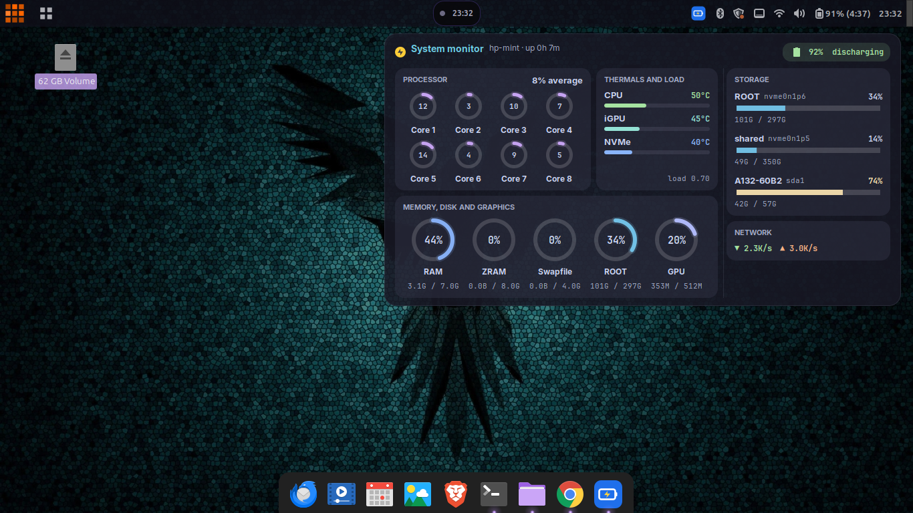
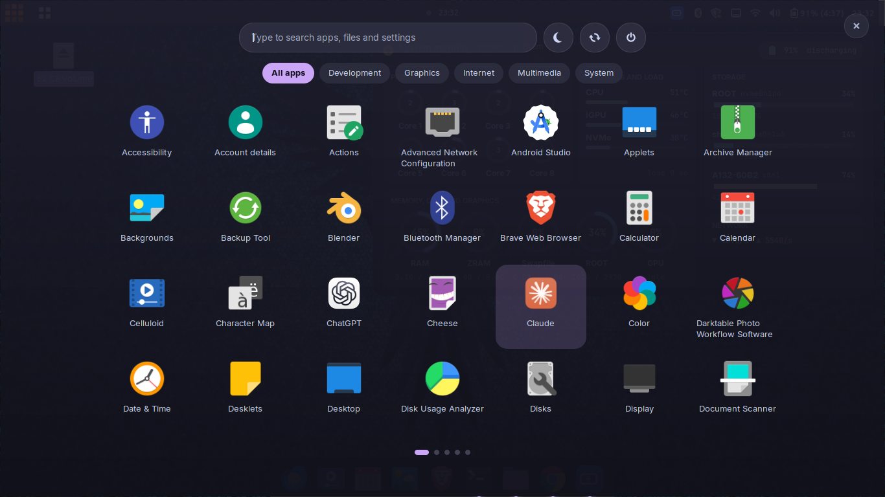

# jarvis_mint

Two Cinnamon add-ons for a JARVIS-style Linux Mint desktop: a system-monitor
desklet and a full-screen app drawer. Both use the **Catppuccin Mocha** palette.

Built and tested on Linux Mint 22.3, Cinnamon 6.6, 1366×768, AMD Ryzen with
Radeon 610M graphics.



| Add-on | What it is |
|---|---|
| [Jarvis Monitor](monitor/) | Desklet: CPU cores, thermals and load, RAM / ZRAM / swap / disk / GPU rings, storage, network, battery |
| [Jarvis Drawer](drawer/) | Panel applet: full-screen, paged app launcher opened with `Super`, with search and category chips |

<p>
  
  
</p>

## Install

### From a .deb (recommended)

```bash
packaging/build.sh                 # or: packaging/build.sh monitor | drawer
sudo apt-get install -y ./packaging/dist/jarvis-monitor-desklet_*.deb \
                        ./packaging/dist/jarvis-drawer-applet_*.deb
cinnamon --replace &
```

The packages install into `/usr/share/cinnamon/{desklets,applets}/`. Each build
gets the version `<metadata version>+<timestamp>`, so a rebuild is always an
upgrade.

### For development

Symlink the folders into your user directory:

```bash
ln -s "$PWD/monitor/jarvis-monitor@harish" ~/.local/share/cinnamon/desklets/
ln -s "$PWD/drawer/jarvis-drawer@harish"   ~/.local/share/cinnamon/applets/
```

Cinnamon prefers `~/.local/share/cinnamon/` over `/usr/share/cinnamon/`, so
remove these symlinks before switching to the packages, or they will shadow the
installed copies.

Then add **Jarvis Monitor** in *Desklets* and **Jarvis Drawer** in *Applets*.
To let `Super` open the drawer, clear the overlay key of any other menu applet
that is using it.

**After editing:** `desklet.js` and `applet.js` changes need `cinnamon --replace &`
(about 15 seconds). `metadata.json`, `settings-schema.json` and `stylesheet.css`
reload live.

## Fonts

The stylesheets ask for **Inter** and **JetBrains Mono**. To install JetBrains
Mono, run `sudo apt install fonts-jetbrains-mono`. Inter v4 registers itself as
*"Inter Variable"*, so add a fontconfig alias from `Inter` to `Inter Variable`.
Without it, a stylesheet asking for `"Inter"` silently falls back to the default
sans font.

## The look

Both add-ons set their own colours, so changing the shell theme doesn't change
how they look.

| Role | Colour |
|---|---|
| Ground | `#181825` / `#1e1e2e` |
| Accent | `#cba6f7` mauve |
| Text | `#cdd6f4` |
| Muted | `#a6adc8` / `#6c7086` |
| Good / warn / bad | `#a6e3a1` / `#f9e2af` / `#f38ba8` |

The monitor's rings have fixed colours per metric (RAM blue, ZRAM yellow,
Swapfile teal, ROOT sky, GPU lavender). The storage bars and the battery pill
change colour with severity.

To bring the rest of the desktop (terminal, file manager, panel, window borders,
dock, folder icons) onto the same palette, see [docs/THEMING.md](docs/THEMING.md).

## Hardware notes

- Temperature sensors are found by hwmon **name** (`k10temp`, `amdgpu`,
  `nvme`), because hwmon numbers change between boots. Other CPUs or GPUs need
  their driver name added in `desklet.js`.
- GPU busy % and VRAM come from amdgpu's sysfs files. On other GPUs the GPU ring
  hides itself.
- On some laptops, reading the battery, the AC adapter or the NVMe temperature
  can take 0.05–1 s. A synchronous read would freeze all of Cinnamon, so the
  monitor reads these asynchronously.

## Testing

Cinnamon exposes `org.Cinnamon.Eval` on the session bus, which runs JavaScript
inside the live shell. The tests run there, against the real objects:

```bash
dbus-send --session --print-reply=literal --dest=org.Cinnamon /org/Cinnamon \
  org.Cinnamon.Eval string:"let [ok,c]=imports.gi.GLib.file_get_contents(
    '$PWD/drawer/tests/test_drawer.js');
    eval(imports.byteArray.toString(c));"
```

A reply of `boolean false` means the JavaScript threw an error, and the error
message is lost. Wrap the payload in try/catch and return `e + e.stack` to see it.

| Suite | What it checks |
|---|---|
| `drawer/tests/test_drawer.js` | App list, search, categories, paging, grid sizes at several resolutions, tile sizes. The drawer must be open while it runs. |
| `monitor/tests/test_battery.js` | Every battery state and colour, then restores the real battery state |
| `monitor/tests/dump_state.js` | Dumps every value the monitor shows as JSON, to compare against `/proc` and sysfs |

## Remove

```bash
sudo apt-get remove jarvis-monitor-desklet jarvis-drawer-applet
```
