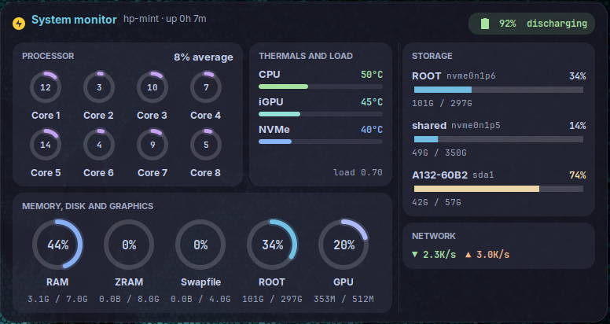

# Jarvis Monitor

A Cinnamon **desklet** that sits on the desktop and reports what the machine is
doing. Source is `jarvis-monitor@harish/`.



## Layout

Taken from pages 10, 11 and 14 of the canvas.

```
┌ System monitor · hp-mint · up 8d 1h ················· [ 56% discharging ] ┐
│                                                                          │
│  ┌ PROCESSOR ─────────────┐  ┌ THERMALS AND LOAD ┐   ┌ STORAGE ────────┐ │
│  │  8 core rings, 4 per   │  │  CPU / iGPU / NVMe │  │  ROOT           │ │
│  │  row, + "n% average"   │  │  bars + load avg   │  │  shared         │ │
│  └────────────────────────┘  └────────────────────┘  │  EXTERNAL       │ │
│  ┌ MEMORY, DISK AND GRAPHICS ──────────────────────┐  └─────────────────┘ │
│  │  RAM   ZRAM   Swapfile   ROOT   GPU  (5 rings)  │  ┌ NETWORK ────────┐ │
│  └─────────────────────────────────────────────────┘  │  ▼ down  ▲ up   │ │
└──────────────────────────────────────────────────────────────────────────┘
```

Processor and Thermals sit side by side, memory spans beneath them, Storage and
Network stack on the right. The panel is 773px wide and **sizes its own height**
to whatever the content needs.

## Decisions made along the way

**No line graph.** An early version had a CPU history sparkline. The board has
none, so it went. `_cpuHistory` is still kept, but only to compute the average.

**Fixed ring colours, not severity colours.** Rings are coloured by *what they
measure*, so the card reads as a legend. Severity shifting was the older
behaviour and was dropped deliberately. Storage bars kept it.

**Processor name removed** — the average on the right says more in less space.

**Battery shows state, not forecast.** "57% discharging", never "2:14 left".
Time-remaining estimates are noise on a machine that's usually plugged in.

**Storage grows downward.** The list is top-aligned and evenly stacked so a new
volume appends to the bottom instead of the rows redistributing themselves.
Verified: rows sit at y=0, 64, 128 with a single 64px gap.

**Thermals placed right of Processor**, matching its height, filling what was
dead space in the first build.

## Findings

**A container's preferred height can exceed its tallest child.** The content row
reported 418px when its tallest column needed 359 — and both columns were then
allocated 418, leaving a visible empty strip under the cards. Six screenshot
cycles guessed at this; one `get_allocation_box()` probe settled it. Fix is
`_fitPanelToContent()`, which measures both columns and pins the row:

```js
let rowH = Math.ceil(Math.max(lh, rh));
this._content.height = rowH;
```

**Clutter does not clip.** With the panel height hard-coded too small, the
Network card simply drew *outside* the rounded panel — no warning, no error.

**`set_style()` replaces, it does not merge.** Two calls on one actor meant the
second silently wiped every card background. This cost several rounds.

**Theme chrome wraps desklets.** `org.cinnamon desklet-decorations = 1` wraps
every desklet in `.desklet-with-borders`, which in the Orchidea theme adds a
black 0.6 background, a drop shadow **and 12px of padding** — all outside the
desklet's own drawing. That was the mystery shadow and the extra space. Fixed
per-widget with `"prevent-decorations": true` in `metadata.json`, rather than
changing the global setting.

**hwmon numbering moves between boots**, so sensors are resolved by *name*
(`k10temp`, `amdgpu`, `nvme`), never by `hwmon4`.

**`_fsInfo` returns `{size, used}`, not `total`.** The ROOT ring silently
rendered blank until that was spotted.

**Panel overran the screen** at 798px wide starting from x=650 on a 1366px
display. Moved to x=530.

## Test results — 2026-09-27

Every displayed value was diffed against what the system actually reports.
**51 passed, 0 failed.**

| Check | Displayed | System |
|---|---|---|
| RAM | 76% | 76.3% (`/proc/meminfo`) |
| ZRAM | 44% `3.5G / 8.0G` | 44.0% (`/proc/swaps`) |
| Swapfile | 0% `0.0B / 4.0G` | 0 used of 4194300 kB |
| ROOT | 26% `77G / 297G` | 26.0% (`df`) |
| CPU temp | 41°C | 41.1°C (`k10temp`) |
| iGPU temp | 40°C | 40.0°C (`amdgpu`) |
| NVMe temp | 35°C | 35.9°C (`nvme`) |
| Uptime | up 8d 1h | 8d 1h (`/proc/uptime`) |

One apparent failure turned out to be the *test* being wrong: `/proc/meminfo`
conflates zram and the swapfile into one `SwapTotal`, so it reported 29.4% swap
in use while the Swapfile ring said 0%. Reading `/proc/swaps` per-device proved
the desklet right — the 3.5G is entirely zram, which has its own ring.

**Battery — 19/19.** `_updateBattery` reads through `this._readFile`, so swapping
that method drives every state without touching the real battery:

| State | Colour | |
|---|---|---|
| Charging, any % | `#a6e3a1` green | charging wins over a low reading |
| Discharging ≥50% | `#a6e3a1` green | |
| Discharging 30–49% | `#f9e2af` yellow | |
| Discharging <30% | `#f38ba8` red | |
| No battery present | — | row hidden, not shown as 0% |

The pill tint tracks the same state, the icon ramps full → good → low → caution,
and no state ever prints a time estimate.

**Hot-plug — passes.** Injecting fake `/proc/mounts` lines: 3 → 4 → 5 gauges,
panel 417 → 423 → 487px, an unlabelled volume correctly became "EXTERNAL 2", and
unplugging returned it to exactly 417px with nothing drawing outside the panel.

## Known cosmetic issue

The third storage row reads **EXTERNAL** but is `nvme0n1p3` — an internal
partition that happens to be mounted under `/media/`. The label is inferred from
the mount path, so anything there reads as external. Checking whether the device
is actually removable would fix it.

## Tests

- `tests/dump_state.js` — dumps everything the desklet is displaying as JSON,
  for diffing against the system.
- `tests/test_battery.js` — drives all battery states and restores the real one.

Run them through `org.Cinnamon.Eval`; see the [root README](../README.md).
